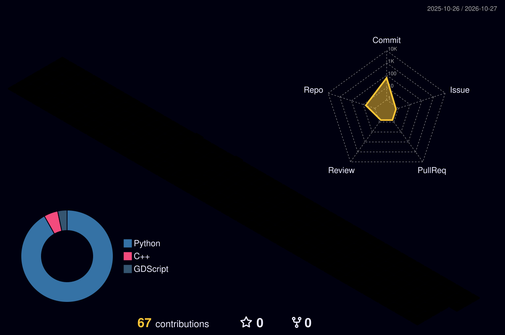

###  Nice ways to reach me

----

안녕하세요, **송준섭**입니다. Unreal Engine·Godot·Unity로 게임을 만들고, Python·FastAPI로 백엔드를 개발합니다.

----

### Personal stats:

  
Highlights / Proficiencies

   

  **Highlights**

  - ⭐ [부산 배경 리듬 게임](https://github.com/sjs9668/Busan-Content-Contest) — Godot로 노트 생성·입력 판정·점수·게임 진행 시스템을 구현.
  - ⭐ [검의 미식](https://github.com/sjs9668/The-Sword-s-Gourmet) — Unreal Engine으로 도축·요리·음식 능력치 반영과 UI를 개발.
  - ⭐ [Unknown Entity](https://github.com/ProgrammingNetwork-PNN/Unknown_Entity) — Unity에서 키 카드·씬 전환·사운드 적용을 담당.
  - ⭐ [캐릭터 분석 심문 추론 게임](https://github.com/sjs9668/unserver) — FastAPI 백엔드 전반과 음성 질문·답변·NPC 상태·모순 판단을 구현.
  - ⭐ [법률 위반 경고 AI 서비스](https://github.com/Znsim/Capstone) — 분석 흐름 제어, 회원 API, 임베딩·RAG 검색을 구현.
  - ⭐ [중고거래 및 경매 플랫폼](https://github.com/sjs9668/CPBack) — 회원 API·DB 연동·상품 반응·경매 낙찰 처리를 구현.

   

  **Proficiencies**

  - 📚 Languages: C, C++, C#, Python, GDScript
  - 🎮 Game Engines & Tools: Unreal Engine, Godot, Unity, FFmpeg
  - ⚙️ Backend & Data: FastAPI, SQLAlchemy, PostgreSQL, Redis
  - 🔧 Collaboration: Git, GitHub

### 💪 Skills

----

