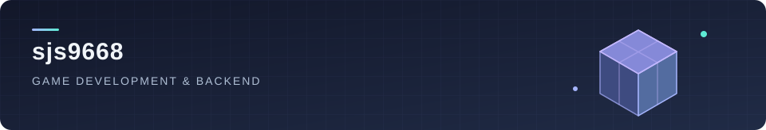
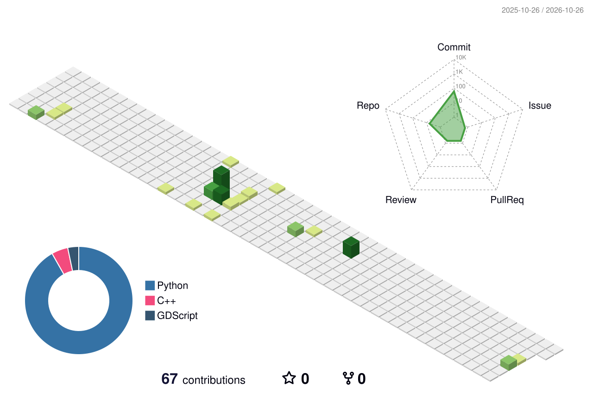

  

<h1 align="center">Hi, I'm 송준섭 👋</h1>

  <b>게임의 상호작용부터 서비스의 흐름까지, 코드로 연결합니다.</b> 
  Unreal Engine · Godot · Unity · Python Backend

  
  

---

### 👨‍💻 About me

게임 플레이를 구현하고, 이를 뒷받침하는 시스템을 만듭니다.  
Unreal Engine과 Godot, Unity로 게임을 만들고 Python과 FastAPI로 백엔드를 개발해 왔습니다.

- 🎮 **Game** — 음성 기반 AI 심문, 레시피 기반 요리, 타이밍 판정과 강화 시스템
- ⚙️ **Backend** — 회원 API, 비동기 DB 연동, 찜 기능과 경매 낙찰 처리
- 🌱 **Foundation** — C/C++ 학습과 알고리즘 문제 풀이 기록

<b>개발 경험 자세히 보기</b>

 

- **Unreal Engine / C++**  
  마이크 녹음과 서버 요청, 응답 음성 재생을 연결한 심문 게임과 재료·레시피 기반 요리 시스템을 구현했습니다.
- **Godot / GDScript**  
  방향키 입력에 따른 타이밍 판정, 콤보·HP, 스테이지별 강화를 갖춘 리듬 게임을 만들었습니다.
- **Python / FastAPI**  
  팀 프로젝트에서 회원가입·탈퇴, SQLAlchemy 비동기 DB 연동, 조회수·좋아요·찜 목록, 경매 낙찰 처리를 담당했습니다.
- **Unity / C#**  
  2D 게임과 네트워크 기능을 다룬 프로젝트 경험이 있습니다.

### 🛠 Tech stack

**Languages**

  
  
  
  
  

**Game development**

  
  
  

**Backend & data**

  
  
  
  

**Tools**

  
  
  

### 🚀 Selected projects

| Project | What I built | Stack |
| :--- | :--- | :--- |
| 🎙️ [AI 심문·추리 게임](https://github.com/sjs9668/Voice-Based-AI-Interrogation-and-Deduction-Game) | 마이크 녹음 → 서버 문답 → NPC 음성 재생으로 이어지는 상호작용 | Unreal Engine · C++ |
| 🍳 [The Sword's Gourmet](https://github.com/sjs9668/The-Sword-s-Gourmet) | 재료 선택과 레시피 매칭을 바탕으로 한 요리 시스템 | Unreal Engine · C++ |
| 🎵 [Busan Content Contest](https://github.com/sjs9668/Busan-Content-Contest) | 타이밍 판정, 콤보·HP와 단계별 강화를 결합한 리듬 게임 | Godot · GDScript |
| 🛒 [CPBack](https://github.com/sjs9668/CPBack) | 중고거래·경매 플랫폼의 회원·DB·찜·낙찰 처리 기능 | Python · FastAPI · PostgreSQL |

### 🌱 My contribution garden

  <picture>
    <source media="(prefers-color-scheme: dark)" srcset="./profile-3d-contrib/profile-night-rainbow.svg" />
    
  </picture>

작은 구현을 쌓아, 하나의 경험으로.

